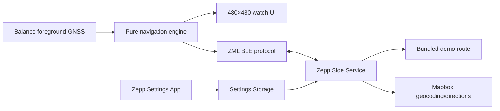

# Architecture

The Device App owns foreground location, route progress, alerts, UI, and resumable session state. ZML provides one managed BLE request/call channel and cleans up its listeners with app/page lifecycle destruction. The Side Service owns network and settings access, normalizes provider data, caps geometry at 500 points, and sends compact route models. The Settings App never runs on the watch.

There is deliberately no App Service. Zepp background services cannot provide a navigation UI and are unsuitable for live high-power GNSS. Protocol structures and pure routing logic live under `shared/`.
